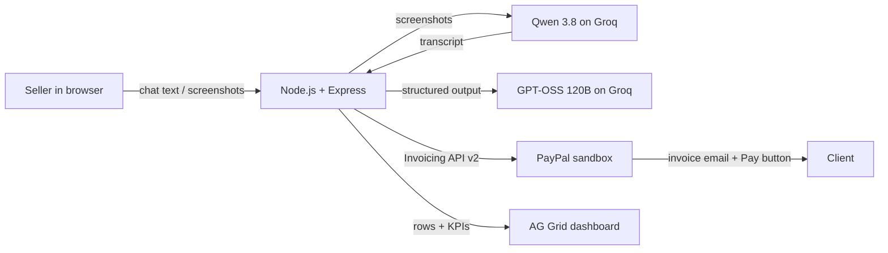

# PayNudge: from client chat to paid

**An AI receivables agent for freelancers and small businesses.** Paste a client conversation or drop a chat screenshot, in any language. AI (GPT-OSS 120B and Qwen 3.8 on Groq) drafts the invoice, the **PayPal Invoicing API** creates and sends it, and PayNudge follows up with AI-written reminders until the client pays.

**Live demo:** https://paynudge-sz4i.onrender.com (PayPal sandbox + Groq on free plans. A GitHub Action pings it every 10 minutes to keep it awake; if it was asleep anyway, the first load can take up to a minute.)

> Built for the PayPal AI Hackathon "Build What's Next with PayPal and AI".

## The problem

Freelancers agree on work in WhatsApp, Telegram and email threads, often in several languages. Then come the tedious parts: copying the scope into an invoice, remembering who hasn't paid, and writing awkward "just checking in…" messages. Late payments cost freelancers real money, and most never chase them consistently.

## What PayNudge does

1. **Chat → invoice.** Paste a conversation or upload screenshots. The AI finds the client, line items, quantities, prices, currency and due date ("pay within 10 days after delivery" becomes a date). It writes everything in English even when the chat is in Russian or Spanish, and it flags anything doubtful, such as a missing email or "about 20 photos".
   For each item, PayNudge asks the model for an exact source excerpt and only shows it when it matches the chat or screenshot transcript. A match helps review but does not prove that the amount was agreed; screenshot transcription can be wrong. Editing an item clears the excerpt.
   If the vision model is unavailable, **Read screenshot locally** uses browser-based Tesseract OCR for English, Russian and Spanish. The first use downloads language data; the screenshot is processed on the device, and you can correct the extracted text before sending it to the AI provider. OCR can make mistakes and requires manual review.
2. **Human review, then PayPal.** Every field stays editable. One click creates the invoice through the PayPal Invoicing API and sends it, so the client gets PayPal's email with a "Pay" button. If there is no email, PayPal returns a payment link to drop into the chat.
3. **Receivables in one table.** An AG Grid dashboard reads invoice status live from PayPal: paid, sent, overdue and how late, with a suggested next step for each invoice. Choose an aging group to filter the table, then select invoices to prepare a focused reminder batch.
4. **AI nudges, sent by PayPal.** For overdue invoices the AI writes a reminder in the tone that fits (friendly, firm or final notice) and in the client's original language. You approve it, and PayPal's `remind` endpoint emails it with the pay button.
5. **Collections review.** Select invoices in AG Grid, or leave all unselected to review the current aging group (or the full ledger if no group is selected). The app prepares up to eight overdue reminders, choosing a tone from how late each invoice is (1–7 days friendly, 8–21 firm, 21+ final notice). Recent PayPal contact is unchecked by default. Review and edit the batch before PayPal sends it. This is user-initiated, not a background scheduler; PayPal's last-sent timestamp is a contact indicator, not a complete reminder history.
6. **Receivables copilot.** Ask "Who should I chase first?" The AI answers from your live PayPal data and proposes one-click actions.
7. **Insights and a live agent feed.** A receivables aging chart (not due, 1–7, 8–21, 21+ days) and an activity feed of everything the AI and PayPal did: drafts, sent invoices, reminders, payments.
   The collection plan surfaces up to three oldest overdue invoices that have no recent or unconfirmed contact. Its ranking is an explicit age-based rule, not an AI prediction; each recommendation can open a reminder or be selected in AG Grid for review as a batch.
8. **The payment moment.** After an invoice is sent, the dashboard checks PayPal every 4 seconds (15 seconds otherwise). When the client pays, it announces "Bloom Coffee just paid $690", the row lights up and the KPIs update.

The AI never sends anything on its own. Every invoice and reminder is reviewed by a person first.

If an invoice request is interrupted, PayNudge keeps the reviewed draft and its operation ID in the current browser tab's session storage. Retrying uses the same PayPal request ID and checks the existing invoice before sending. The draft is locked while its outcome is uncertain. Check PayPal before choosing to start over: request IDs have a provider-defined retention period, and a closed tab or cleared session storage loses the recovery information. Demo-mode data is in memory and disappears on server restart.

PayNudge records reminder attempts locally (invoice ID, timestamp, and delivery state only). A recent reminder or an unconfirmed attempt is excluded from batch selection and requires explicit confirmation before another send. The default `data/reminders.json` survives a local process restart, but Render's free filesystem is ephemeral; use `REMINDER_HISTORY_FILE` on persistent storage for durable history. This is a single-instance journal, not a multi-instance database or a complete record of reminders sent outside PayNudge. Always check PayPal if delivery is unconfirmed.

The shared demo applies in-memory per-client request limits on AI and invoice/reminder writes. On Render it trusts one proxy hop to distinguish visitors; other proxy topologies require their own configuration. Rate limits are not authentication and are not shared across instances. The API status endpoint reports the deployed Render commit when available.

### Try it in 60 seconds (live demo)

1. Click **Try it with a sample chat**: the AI drafts an invoice from a real-looking client chat.
2. Click **Create & send via PayPal**, then **Open client's payment page** to see the real PayPal sandbox invoice.
3. Click **Prepare reminders** to have the AI draft reminders for the overdue invoices in English, Russian and Spanish, then review them before PayPal sends anything.
4. Ask the copilot "Who should I chase first?"

For a reproducible end-to-end demo and video outline, see [docs/DEMO.md](docs/DEMO.md).

## How PayPal is used

| Step | PayPal API call |
|---|---|
| Authenticate | `POST /v1/oauth2/token` (client credentials) |
| Create invoice from the AI draft | `POST /v2/invoicing/invoices` |
| Send it, or create a share link | `POST /v2/invoicing/invoices/{id}/send` |
| Dashboard and copilot data | `GET /v2/invoicing/invoices` |
| Invoice details for a reminder | `GET /v2/invoicing/invoices/{id}` |
| Send the AI-written reminder | `POST /v2/invoicing/invoices/{id}/remind` |
| Payment updates (polling) | `GET /v2/invoicing/invoices` every 4–15 seconds |
| Payment updates (webhook, see note) | Webhook `INVOICING.INVOICE.PAID` (also `CANCELLED`, `REFUNDED`) → `POST /api/paypal/webhook` |
| Prove a webhook is genuine | `POST /v1/notifications/verify-webhook-signature` |

**Payment updates: what is proven and what is not.** The dashboard reliably notices payments by polling PayPal every 4–15 seconds; this is what showed sandbox invoices #0008 and #0009 as paid after a real sandbox buyer paid them.

PayNudge also accepts PayPal webhooks. With `PAYPAL_WEBHOOK_ID` set, the server verifies every delivery with PayPal (`verify-webhook-signature`) before using it and pushes it to open dashboards over Server-Sent Events. On the live demo a forged "invoice paid" request was rejected with `400 Webhook signature is not valid` and never reached the activity feed.

However, we have **not yet seen a real webhook arrive**. In our test (Nov 11, 2026) the webhook was registered for the right URL and events, the sandbox buyer paid invoice #0009, and PayPal's own event list for the app (`GET /v1/notifications/webhooks-events`) stayed empty: the sandbox did not generate an `INVOICING.INVOICE.PAID` event, so there was nothing to deliver. Until a real event is received, treat webhooks as implemented but unverified end to end; polling is the path that is known to work.

To enable it: PayPal Developer Dashboard → Apps & Credentials → your sandbox app → **Add Webhook**, URL `https://<your-app>/api/paypal/webhook`, events `Invoicing invoice paid`, `cancelled`, `refunded`. Copy the webhook ID into `PAYPAL_WEBHOOK_ID`.

**What "Collected" means.** PayPal status `PAID` counts as *paid via PayPal*. `MARKED_AS_PAID` is a payment the seller recorded manually (the sandbox seed script creates one such invoice); the dashboard shows the two amounts separately.

PayPal is the source of truth: PayNudge has no database. The AI's deal summary and the client's language are kept in the invoice's private `memo` field, so later reminders have that context.

## How AI is used

PayNudge runs on **Groq's free plan** with two open models:

- **GPT-OSS 120B** (`openai/gpt-oss-120b`, medium reasoning) does the thinking: invoice extraction, reminders and the copilot. Every call uses **strict structured output**, so the response is constrained to a JSON schema and the app can act on it safely.
- **Qwen 3.8 27B** (`qwen/qwen3.8-27b`) only reads screenshots: it transcribes the chat to text, and GPT-OSS then builds the invoice from that transcript.

The sample chats include English, Russian and Spanish. The model can resolve a relative payment date when its reference date is clear; dates and amounts always need human review.

**Measured check:** on 16 hand-written client chats in English, Russian, Spanish and Kazakh (cancelled items, an unapproved quote, a price changed later, "$1.5k", hourly rates, a deposit already paid, a discount, yen, an email in a signature, missing email, explicit and unknown due dates), the live model got **16/16 chats fully correct** (total, currency, items, email, due date, required warnings), **18/18 line items carried a quote that really appears in the chat**, median **2.5 s** per draft. Full table: [docs/AI-EVAL.md](docs/AI-EVAL.md). Reproduce with `npm run evaluate-ai` while the app runs with AI credentials (consumes AI quota).

These are synthetic examples written by us, not real customer data: they show behaviour on known edge cases, not general accuracy. A person must still verify every draft, which is why every line item shows its source quote.

| Feature | Input | Output |
|---|---|---|
| Invoice extraction | chat text and/or screenshots (vision) | client, line items, currency, due date, warnings, private summary |
| Reminder writer | invoice facts, days overdue, chosen tone, original language | email subject and message for PayPal's reminder |
| Receivables copilot | question plus live invoice list from PayPal | short answer and up to 3 proposed actions |

If the main model hits its free quota or returns output that fails the schema, the request is retried once on `openai/gpt-oss-20b`. AI endpoints are also rate-limited per IP to protect a public demo.

The provider is swappable through `.env`: Groq (default), Google Gemini (`AI_PROVIDER=gemini`), or any OpenAI-compatible API (`AI_PROVIDER=openai` with `AI_BASE_URL`, `AI_API_KEY`, `AI_MODEL`).

## Architecture



- `server.js`: REST API and static hosting
- `src/ai.js`: the three AI calls, their JSON schemas and the provider adapters
- `src/paypal.js`: PayPal Invoicing API client (OAuth token caching, idempotency keys)
- `src/invoices.js`: AI draft → PayPal invoice → dashboard row conversions
- `src/mockPaypal.js`: in-memory PayPal stand-in for demo mode
- `src/activity.js`: agent activity log and payment detection between refreshes
- `public/`: front end (vanilla JS + AG Grid Community)

## Run it locally

Requirements: Node.js 20 or newer.

```bash
git clone <this repo>
cd paynudge
npm install
```

**Option A: demo mode (no keys, 30 seconds).** Uses an in-memory PayPal and canned AI answers so you can click through the whole flow:

```bash
npm run demo
```

Open http://localhost:3000.

**Option B: real PayPal sandbox and AI.**

1. Create a sandbox app at [developer.paypal.com](https://developer.paypal.com) → Apps & Credentials → Sandbox → Create App. In the app's Features, make sure **Invoicing** is checked. Copy the client ID and secret.
2. Get a free Groq API key (no card needed) at [console.groq.com](https://console.groq.com) → API Keys → Create API Key.
3. Copy `.env.example` to `.env` and fill in `PAYPAL_CLIENT_ID`, `PAYPAL_CLIENT_SECRET` and `GROQ_API_KEY`.
4. Check the setup (uses no AI quota), then start:

```bash
npm run check
npm start
```

Optional: fill the sandbox with realistic demo invoices (three overdue, one paid, one upcoming, all backdated) so the dashboard, AI nudges and copilot have data to work with:

```bash
npm run seed
```

### Paying a sandbox invoice

1. In the PayPal developer dashboard, open Testing Tools → Sandbox Accounts and copy the email of the **Personal** sandbox account.
2. Put that email in the chat you paste (or in the Email field of the draft) and send the invoice.
3. Click **Open client's payment page** and log in with the personal sandbox account to pay.
4. Click refresh in PayNudge: the invoice moves to **Paid** and the KPIs update.

## Deploy to Render

The repo includes `render.yaml`. In Render: New → Blueprint → select this repo, then fill in `PAYPAL_CLIENT_ID`, `PAYPAL_CLIENT_SECRET` and `GROQ_API_KEY` (and optionally `PAYPAL_WEBHOOK_ID`). `.github/workflows/keep-warm.yml` keeps the free instance awake; change its URL if you deploy your own copy.

## Known limitations

This is a hackathon prototype, and we prefer to say so plainly:

- **Webhooks not verified end to end.** The receiver and its signature check work (a forged request is rejected), but the sandbox did not emit an `INVOICING.INVOICE.PAID` event in our test, so payments are currently noticed by polling within 4–15 seconds.
- **One seller, no login.** The demo runs on one PayPal sandbox account shared by every visitor. Connecting each user's own PayPal account would need PayPal's partner onboarding and a user database.
- **Reminder history is not durable on the free host.** It lives in a local file that Render's free plan can wipe on redeploy. Production needs a database.
- **Screenshot reading depends on a free vision quota.** When Groq's vision model is out of quota, the in-browser OCR fallback works but makes character mistakes, so the text must be reviewed.
- **No user research yet.** We have not measured time saved or faster payment with real freelancers; the AI check above uses synthetic chats.
- **Demo data.** The sandbox contains backdated seed invoices and one manually recorded payment so the dashboard has history; real PayPal payments are shown separately as "paid via PayPal".

## Tools used

- **PayPal Developer Platform:** Invoicing API v2 in the sandbox environment; webhook receiver with signature verification (implemented, not yet seen receiving a real sandbox event)
- **Groq API** (free plan): GPT-OSS 120B extracts invoices, writes reminders and answers copilot questions with strict structured output. Qwen 3.8 27B transcribes chat screenshots. GPT-OSS 20B is the fallback.
- **Google Gemini API** (optional, `@google/genai` SDK): alternative provider
- **AG Grid Community:** receivables table with sorting, search and pagination
- **Render:** hosting
- Node.js, Express, vanilla JavaScript

## License

MIT, see [LICENSE](LICENSE).
