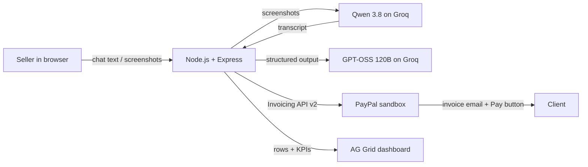

# PayNudge: from client chat to paid

**An AI receivables assistant for freelancers and small businesses.** Paste a client chat, drop a screenshot or record a voice note, in any language. AI drafts the invoice and quotes the chat line behind every item, the **PayPal Invoicing API** creates and sends it, and when a client falls behind, PayNudge offers an AI-drafted **payment plan** that PayPal collects in installments on the same invoice.

**Live demo:** https://paynudge-sz4i.onrender.com (PayPal sandbox + Groq on free plans. On Render the server requests its own public URL every 10 minutes so it stays awake; if it was restarted, the first load can take up to a minute.)

**Demo video (2:58):** https://youtu.be/J-J2dkYSYvA

> Built for the PayPal AI Hackathon "Build What's Next with PayPal and AI".

## The problem

Freelancers agree on work in WhatsApp, Telegram and email threads, often in several languages. Then come the tedious parts: copying the scope into an invoice, remembering who hasn't paid, and writing awkward "just checking in…" messages. Late payments cost freelancers real money, and chasing them is easy to put off.

## What PayNudge does

1. **Chat → invoice.** Paste a conversation or upload screenshots. The AI finds the client, line items, quantities, prices, currency and due date ("pay within 10 days after delivery" becomes a date). It writes everything in English even when the chat is in Russian or Spanish, and it flags anything doubtful, such as a missing email or "about 20 photos".
   For each item, PayNudge asks the model for an exact source excerpt and shows it only when it matches the chat or screenshot transcript, so the seller can confirm each line against the client's own words in seconds. Editing an item clears the excerpt, so a quote always belongs to the text it sits under.
   If the vision model is unavailable, **Read screenshot locally** uses browser-based Tesseract OCR for English, Russian and Spanish. The first use downloads language data; the screenshot is processed on the device, and you can correct the extracted text before sending it to the AI provider. OCR can make mistakes and requires manual review.
   **Voice notes:** record a voice message in the browser (or upload an audio file) describing the job. Whisper on Groq transcribes it into the chat box, where you can read and fix it, and the same extraction builds the invoice with quotes from the transcript. Tested live with an English and a Russian voice note: both produced correct totals ($950 and $350) with quotes for every item; a dictated email address was not recognized and was flagged for review instead of guessed.
2. **Human review, then PayPal.** Every field stays editable. One click creates the invoice through the PayPal Invoicing API and sends it, so the client gets PayPal's email with a "Pay" button. If there is no email, PayPal returns a payment link to drop into the chat.
3. **Receivables in one table.** An AG Grid dashboard reads invoice status live from PayPal: paid, sent, overdue and how late, with a suggested next step for each invoice. Quick views (All, Open, Overdue, On a plan, Paid), column filters (text, number, date), a **paid-progress bar** per invoice with tick marks for each plan installment, **pinned per-currency totals** for the rows in view (currencies are never added together), tooltips and **CSV export** of the current view. Choose an aging group to filter the table, then select invoices to prepare a focused reminder batch.
4. **AI nudges, sent by PayPal.** For overdue invoices the AI writes a reminder in the tone that fits (friendly, firm or final notice) and in the client's original language. You approve it, and PayPal's `remind` endpoint emails it with the pay button.
   **Payment plans instead of pressure.** For a late invoice, **Plan** asks the AI for 2–4 installments and a message. On seller approval PayNudge enables partial payments, saves the offered schedule and payment baseline in PayPal's private memo, and emails the proposal. The original overdue status remains until the seller explicitly records that the client agreed. Only then does the dashboard use the installment dates to track lateness. Plans created before this version have unknown agreement and baseline and need to be re-offered. This is a seller-recorded confirmation, not an automatic record of the client's acceptance.
5. **Collections review.** Select invoices in AG Grid, or leave all unselected to review the current aging group (or the full ledger if no group is selected). The app prepares up to eight overdue reminders, choosing a tone from how late each invoice is (1–7 days friendly, 8–21 firm, 21+ final notice). Recent PayPal contact is unchecked by default. Review and edit the batch before PayPal sends it. This is user-initiated, not a background scheduler; PayPal's last-sent timestamp is a contact indicator, not a complete reminder history.
6. **Receivables copilot.** Ask "Who should I chase first?" The AI answers from your live PayPal data and proposes one-click actions.
7. **Insights and a live agent feed.** A receivables aging chart (not due, 1–7, 8–21, 21+ days) and an activity feed of everything the AI and PayPal did: drafts, sent invoices, reminders, payments.
   The collection plan surfaces up to three oldest overdue invoices that have no recent or unconfirmed contact. Its ranking is an explicit age-based rule, not an AI prediction; each recommendation can open a reminder or be selected in AG Grid for review as a batch.
8. **The payment moment.** After an invoice is sent, the dashboard checks PayPal every 4 seconds (15 seconds otherwise). When the client pays, it announces "Bloom Coffee just paid $690", the row lights up and the KPIs update.

9. **Today's approvals.** Each morning (or on demand) the agent prepares the day's work: a reminder for each overdue invoice not contacted in the last 3 days, a payment-plan offer for invoices more than 21 days late, and any recurring invoice that is due. The seller edits, approves or skips each item in the **Approvals** tab; approval goes through the same checked endpoints as the manual flows.
10. **Seller workspace** (the "Seller" button in the header):
    - **Price list.** After extraction each line item is matched to the seller's services by name. A service agreed without a price gets the list price with a warning; a chat price that differs from the list is kept and flagged. The model sees only service names, never prices.
    - **Recurring invoices.** Monthly or weekly schedules for regular clients. Each occurrence waits in Today's approvals; the queue item's ID is the PayPal request ID, so a retry cannot bill twice.
    - **Telegram.** Link a Telegram chat with a one-time code, forward a client conversation (text, screenshots or a voice note) to the bot, and it replies with the draft and the chat quotes behind each line. One tap creates and sends the invoice and returns the payment link. Unlinked chats can't draft or send.
    - **Your own PayPal account.** A seller pastes the Client ID and Secret of their own PayPal **sandbox** REST app. PayNudge checks them with PayPal (token plus an invoice list call), stores the Secret encrypted with AES-256-GCM, never sends it back to the browser, and signs a session cookie. From then on every PayPal call from that browser uses the seller's own app, so invoices land in their own PayPal account, and the price list, recurring invoices, approval queue, Telegram link and activity are kept per seller. "Disconnect and delete my keys" removes them. Without it, visitors use the shared demo seller. (PayPal partner onboarding, where a seller signs in on PayPal instead, is also built and ready for when PayPal grants partner access.)
11. **Collection metrics** (Insights): median days to pay, share paid by the due date, money collected on payment plans, payments after a PayNudge reminder and overdue balances, from the seller's own PayPal invoices. Speed counts only invoices paid through PayPal, and every number shows how many invoices it rests on.

The AI never sends anything on its own. Every invoice and reminder is reviewed by a person first.

If an invoice request is interrupted, PayNudge keeps the reviewed draft and its operation ID in the current browser tab's session storage. Retrying uses the same PayPal request ID and checks the existing invoice before sending. The draft is locked while its outcome is uncertain. Check PayPal before choosing to start over: request IDs have a provider-defined retention period, and a closed tab or cleared session storage loses the recovery information. Demo-mode data is in memory and disappears on server restart.

PayNudge records reminder attempts (invoice ID, timestamp, and delivery state only). A recent reminder or an unconfirmed attempt is excluded from batch selection and requires explicit confirmation before another send. Reminder history, price lists, recurring schedules, the approval queue, connected sellers and Telegram links live in a small store: PostgreSQL when `DATABASE_URL` is set (one table, survives redeploys; the live demo uses Neon), otherwise `data/store.json` for zero-setup local runs. If a delivery is ever unconfirmed, PayNudge says so and PayPal remains the record to check.

The shared demo protects itself with per-visitor request limits on AI and invoice/reminder writes (on Render it trusts one proxy hop to tell visitors apart). The API status endpoint reports the deployed Render commit, so anyone can see exactly which code is live.

### Try it in 60 seconds (live demo)

1. Click **Try it with a sample chat**: the AI drafts an invoice from a real-looking client chat.
2. Click **Create & send via PayPal**, then **Open client's payment page** to see the real PayPal sandbox invoice.
3. Click **Prepare reminders** to have the AI draft reminders for the overdue invoices in English, Russian and Spanish, then review them before PayPal sends anything.
4. Ask the copilot "Who should I chase first?"

For a reproducible end-to-end demo and video outline, see [docs/DEMO.md](docs/DEMO.md).

## How PayPal is used

| Step | PayPal API call |
|---|---|
| Authenticate | `POST /v1/oauth2/token` (client credentials) |
| Create invoice from the AI draft | `POST /v2/invoicing/invoices` |
| Send it, or create a share link | `POST /v2/invoicing/invoices/{id}/send` |
| Dashboard and copilot data | `GET /v2/invoicing/invoices` |
| Invoice details for a reminder | `GET /v2/invoicing/invoices/{id}` |
| Send the AI-written reminder | `POST /v2/invoicing/invoices/{id}/remind` |
| Turn on installments for a payment plan | `PUT /v2/invoicing/invoices/{id}` with `configuration.partial_payment` and the plan in `detail.memo` |
| Email the client the plan | `POST /v2/invoicing/invoices/{id}/remind` |
| Payment updates (polling) | `GET /v2/invoicing/invoices` every 4–15 seconds |
| Payment updates (webhook, see note) | Webhook `INVOICING.INVOICE.PAID` (also `CANCELLED`, `REFUNDED`) → `POST /api/paypal/webhook` |
| Prove a webhook is genuine | `POST /v1/notifications/verify-webhook-signature` |
| Connect a seller's own account | `POST /v2/customer/partner-referrals` (invoice permission), then `GET /v1/customer/partners/{partner}/merchant-integrations` to confirm the merchant and scope |
| Act for a connected seller | every call above with a `PayPal-Auth-Assertion` header naming their merchant ID |

**Payment updates: two independent signals.** The dashboard notices payments by polling PayPal every 4–15 seconds; this is what showed sandbox invoices #0008 and #0009 as paid the moment a real sandbox buyer paid them.

PayNudge also accepts PayPal webhooks. With `PAYPAL_WEBHOOK_ID` set, the server verifies every delivery with PayPal (`verify-webhook-signature`) before using it and pushes it to open dashboards over Server-Sent Events. On the live demo a forged "invoice paid" request was rejected with `400 Webhook signature is not valid` and never reached the activity feed.

**Real signed webhooks, verified.** On Nov 12, 2026 a sandbox buyer paid invoice #0003 ($1,500, with a payment plan offered and partial payments enabled) on PayPal's payment page. Polling showed it as paid first; about 22 seconds later PayPal delivered an `INVOICING.INVOICE.PAID` webhook, the server verified its signature with PayPal and the activity feed recorded it (`lastWebhookAt` in `/api/status`). Invoices #0005 and #0002 followed the same way, three verified deliveries in all. Because the two signals are independent, a payment still shows up within seconds even if a webhook is delayed.

To enable it: PayPal Developer Dashboard → Apps & Credentials → your sandbox app → **Add Webhook**, URL `https://<your-app>/api/paypal/webhook`, events `Invoicing invoice paid`, `cancelled`, `refunded`. Copy the webhook ID into `PAYPAL_WEBHOOK_ID`.

**What "Collected" means.** PayPal status `PAID` counts as *paid via PayPal*. `MARKED_AS_PAID` is a payment the seller recorded manually (the sandbox seed script creates one such invoice); the dashboard shows the two amounts separately.

PayPal is the source of truth for invoices: PayNudge keeps no invoice copy in its own database (Neon Postgres holds only reminder history, price lists, schedules, the approval queue, connected sellers and Telegram links). The AI's deal summary and the client's language are kept in the invoice's private `memo` field, so later reminders have that context.

## How AI is used

PayNudge runs on **Groq's free plan** with open models:

- **GPT-OSS 120B** (`openai/gpt-oss-120b`, medium reasoning) does the thinking: invoice extraction, reminders, payment plans and the copilot. Every call uses **strict structured output**, so the response is constrained to a JSON schema and the app can act on it safely. If an output misses the schema, the same model is asked once more, then `gpt-oss-20b`.
- **Qwen 3.8 27B** (`qwen/qwen3.8-27b`) only reads screenshots: it transcribes the chat to text, and GPT-OSS then builds the invoice from that transcript.
- **Whisper large v3 turbo** (`whisper-large-v3-turbo`) turns voice notes into text.

The sample chats include English, Russian and Spanish. The model can resolve a relative payment date when its reference date is clear; dates and amounts always need human review.

**Measured check:** one recorded run passed the selected checks for **16/16 hand-written chats**, with **18/18 extracted items carrying a matching quote** and a median of **1.9 s** per draft. The selected checks differ by case and do not validate every field or establish general accuracy. Full table: [docs/AI-EVAL.md](docs/AI-EVAL.md). Reproduce with `npm run evaluate-ai` while the app runs with AI credentials (consumes AI quota).

These are synthetic examples written by us, so no customer data is involved. Every draft goes to the seller for review, with the matching source excerpt beside each line.

| Feature | Input | Output |
|---|---|---|
| Invoice extraction | chat text and/or screenshots (vision) | client, line items, currency, due date, warnings, private summary |
| Reminder writer | invoice facts, days overdue, chosen tone, original language | email subject and message for PayPal's reminder |
| Receivables copilot | question plus live invoice list from PayPal | short answer and up to 3 proposed actions |
| Voice note → text | recorded or uploaded audio (any language) | transcript the seller reviews before drafting |
| Payment plan | late invoice, balance, days late, original language | 2–4 installments (re-checked by the server) and a message in the client's language |

If the main model hits its free quota or returns output that fails the schema, the request is retried once on `openai/gpt-oss-20b`. AI endpoints are also rate-limited per IP to protect a public demo, and a text chat identical to one already drafted that day (such as a sample chat) reuses that draft instead of calling the AI again, so visitors trying the samples don't use up the shared free quota.

The provider is swappable through `.env`: Groq (default), Google Gemini (`AI_PROVIDER=gemini`), or any OpenAI-compatible API (`AI_PROVIDER=openai` with `AI_BASE_URL`, `AI_API_KEY`, `AI_MODEL`).

## Architecture



- `server.js`: REST API and static hosting
- `src/ai.js`: the three AI calls, their JSON schemas and the provider adapters
- `src/paypal.js`: PayPal Invoicing API client (OAuth token caching, idempotency keys)
- `src/invoices.js`: AI draft → PayPal invoice → dashboard row conversions
- `src/mockPaypal.js`: in-memory PayPal stand-in for demo mode
- `src/activity.js`: agent activity log (per seller) and payment detection between refreshes
- `src/store.js`: key-value store (PostgreSQL or JSON file)
- `src/context.js`, `src/accounts.js`: which seller a request acts for; PayPal partner onboarding and signed session cookies
- `src/catalog.js`, `src/recurring.js`, `src/queue.js`, `src/metrics.js`: price list, recurring schedules, daily approval queue, collection metrics
- `src/telegram.js`: Telegram bot (webhook on Render, long polling locally)
- `public/app.js` + `public/js/`: front end as ES modules (vanilla JS + AG Grid Community), one module per feature

## Run it locally

Requirements: Node.js 20 or newer.

```bash
git clone <this repo>
cd paynudge
npm install
```

**Option A: demo mode (no keys, 30 seconds).** Uses an in-memory PayPal and canned AI answers so you can click through the whole flow:

```bash
npm run demo
```

Open http://localhost:3000.

**Option B: real PayPal sandbox and AI.**

1. Create a sandbox app at [developer.paypal.com](https://developer.paypal.com) → Apps & Credentials → Sandbox → Create App. In the app's Features, make sure **Invoicing** is checked. Copy the client ID and secret.
2. Get a free Groq API key (no card needed) at [console.groq.com](https://console.groq.com) → API Keys → Create API Key.
3. Copy `.env.example` to `.env` and fill in `PAYPAL_CLIENT_ID`, `PAYPAL_CLIENT_SECRET` and `GROQ_API_KEY`.
4. Check the setup (uses no AI quota), then start:

```bash
npm run check
npm start
```

Optional: fill the sandbox with realistic demo invoices (three overdue, one paid, one upcoming, all backdated) so the dashboard, AI nudges and copilot have data to work with:

```bash
npm run seed
```

### Paying a sandbox invoice

1. In the PayPal developer dashboard, open Testing Tools → Sandbox Accounts and copy the email of the **Personal** sandbox account.
2. Put that email in the chat you paste (or in the Email field of the draft) and send the invoice.
3. Click **Open client's payment page** and log in with the personal sandbox account to pay.
4. Click refresh in PayNudge: the invoice moves to **Paid** and the KPIs update.

## Deploy to Render

The repo includes `render.yaml`. In Render: New → Blueprint → select this repo, then fill in `PAYPAL_CLIENT_ID`, `PAYPAL_CLIENT_SECRET` and `GROQ_API_KEY` (and optionally `PAYPAL_WEBHOOK_ID`). Optional: `DATABASE_URL` (PostgreSQL, for data that survives redeploys), `TELEGRAM_BOT_TOKEN` (from @BotFather; the webhook is registered automatically at start), `PAYPAL_PARTNER_MERCHANT_ID` (the app owner's sandbox merchant ID; switches on "Connect PayPal") and `SESSION_SECRET` (signs seller cookies). On Render the server pings its own `RENDER_EXTERNAL_URL` every 10 minutes so the free instance stays awake (about 744 of the 750 free instance hours in a 31-day month; set `KEEP_AWAKE=false` to turn it off). `.github/workflows/keep-warm.yml` is a backup ping, but GitHub runs scheduled workflows on a best-effort basis, often hours apart; change its URL if you deploy your own copy.

## Verified live, and how it is built to hold up

Everything below was run against the real PayPal sandbox and the live demo:

- **Two payment signals.** Three real signed `INVOICING.INVOICE.PAID` deliveries were received and verified with PayPal on Nov 12 (invoices #0003, #0005, #0002), and polling every 4–15 seconds runs alongside, so a payment appears within seconds either way.
- **Installments the client can choose.** For plan invoices PayPal confirms `allow_partial_payment: true` and its payer page shows "Minimum due". After "Continue to Payment" the client picks "Full amount" or "Partial amount", so they can clear the whole invoice at once (as the buyers of #0003, #0005 and #0002 did on Nov 12) or pay one installment. The dashboard's paid-progress bar and installment ticks handle part payments, covered by automated tests.
- **Every seller on their own PayPal.** Sellers connect their own sandbox REST app keys, which PayPal allows for any developer account, and every call then runs under their own token. PayPal partner onboarding ("Sign in with PayPal") is also built and switches on with one setting (`PAYPAL_PARTNER_MERCHANT_ID`) once PayPal grants this app partner access; the sandbox currently reserves the Partner Referrals API for approved partners.
- **Nov 12 features, checked on the live demo:** the price list matched all three lines of a real AI draft; an approval-queue reminder was approved and PayPal emailed it (Russian, #0004); a recurring schedule reached the queue and its approval made PayPal send invoice #0012, with the next one scheduled for Dec 12; the Telegram bot turned a pasted chat into sandbox invoice #0010; collection metrics read the real sandbox invoices. Settings are stored in Neon Postgres. "Chat to sent invoice" time is measured on every invoice sent from the web or Telegram since Nov 12 and shown in Insights.
- **Durable storage.** Reminder history, price lists, recurring schedules, the approval queue, connected sellers and Telegram links live in Neon Postgres and survive redeploys; without `DATABASE_URL` the app falls back to a local file, so it runs anywhere with zero setup.
- **Screenshots always readable.** Groq's vision model transcribes chat screenshots; if its free quota runs out, an in-browser OCR fallback (Tesseract.js) takes over automatically, and the seller reviews the text as with every draft.
- **Next: field testing.** The AI check uses 16 synthetic chats in four languages; the next step is measuring time saved and days-to-paid with working freelancers, using the chat-to-sent and collection metrics already built in.
- **Clearly labelled history.** The sandbox includes backdated seed invoices so the dashboard has history from the first visit; real PayPal payments are marked "paid via PayPal" so they are never confused with seed data.

## Tools used

- **PayPal Developer Platform:** Invoicing API v2 in the sandbox environment; webhook receiver with signature verification (three real sandbox events received and verified)
- **Groq API** (free plan): GPT-OSS 120B extracts invoices, writes reminders and payment plans, and answers copilot questions with strict structured output. Qwen 3.8 27B transcribes chat screenshots, Whisper large v3 turbo transcribes voice notes. GPT-OSS 20B is the fallback.
- **AG Grid Community:** receivables table with quick views, column filters, progress cells, pinned per-currency totals, tooltips, row selection and CSV export
- **Google Gemini API** (optional, `@google/genai` SDK): alternative provider
- **Render:** hosting
- Node.js, Express, vanilla JavaScript

## License

MIT, see [LICENSE](LICENSE).
